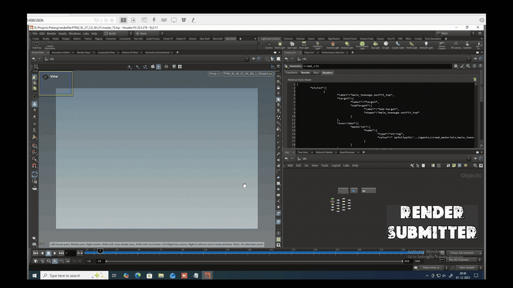

# Mantra & Karma Render Submitter

A powerful, lightweight Python / PySide2 tool for **SideFX Houdini** to batch submit and manage renders across **Mantra** and **Karma (Solaris / USD / LOPs)** engines in one go.



*(Full 1080p recording available in the repo: [Render Submitter.mp4](Render%20Submitter.mp4))*

---

## Why I Built This

Managing multi-shot batch renders across Karma and Mantra while babysitting frame ranges was eating up hours in production. I built this tool to automate shot submission from CSV, run rapid FML test frames, and recover seamlessly from render crashes without re-rendering completed work.

---

## Features

- **Dual Engine Support:** One-click submission for both **Karma** (USD/LOPs) and **Mantra** (IFD/ROPs).
- **CSV Shot Ingestion:** Reads shot lists, frame ranges, and camera paths automatically.
- **Grouping & Search:** Organize shots into custom groups (saved to `shot_groups.json`) with color tags and live search.
- **FML Render Mode:** Renders only First, Middle, and Last frames for fast review.
- **Auto-Run Sequence:** Automatically renders the remaining sequence frames after FML completion.
- **Crash Recovery:** Session tracking (`render_progress_<session>.json`) skips completed frames and resumes failed renders.
- **2K / 4K Presets:** Quick global resolution toggle.
- **Dry Run Mode:** Preview node parameters and paths in the log before launching heavy render jobs.
- **Auto Folder Setup:** Creates missing `Parameters/` and `Output data/` folders automatically.
- **Live Progress Tracking:** Dual progress bars showing real-time shot and frame progress.

---

## Installation & Running in Houdini

No complex setup is required. You can run the tool directly inside Houdini.

### Option 1: Add it as a Shelf Tool (Recommended)

1. Right-click on any shelf in Houdini and select **New Tool...**
2. Name it `render_submitter` and set the label to `Render Submitter`.
3. Under the **Script** tab, set the language to **Python** and add:

```python
import sys

# Update this path to where you saved the tool repository
tool_dir = r"D:/Render Submitter"

if tool_dir not in sys.path:
    sys.path.append(tool_dir)

import render_submitter
render_submitter.run_tool()
```

4. Hit **Apply** and click the new shelf icon to launch the window.

### Option 2: Python Source Editor / Python Shell

You can also run it directly in Houdini's **Python Shell** or paste the script into the **Python Source Editor** (**Windows > Python Source Editor**):

```python
exec(open(r"D:/Render Submitter/render_submitter.py").read())
```

---

## Typical Workflow

1. **Load CSV:** Browse to select your shot CSV list in the tool.
2. **Select Shots:** Click **Select Shots** to open the dialog, search, and group the shots you want to render.
3. **Configure Settings:**
   - Choose your resolution (**2K** or **4K**).
   - Enter a **Session Name** and check **Enable Retry Mechanism** for crash recovery.
   - Keep **Dry Run** enabled if you want to inspect node parameters in the log first.
4. **Submit Render:**
   - Click **FML Render** for quick approval frames (optionally enable *Auto-run after FML* to render the rest of the sequence automatically).
   - Or click **Render All** / **Single Frame** directly.
5. **Monitor:** Watch real-time shot and frame progress bars in the UI.

---

## Requirements

[](https://www.sidefx.com/)
[](https://www.python.org/)
[](LICENSE)
[]()

---

## License

MIT License. Free for personal, educational, and studio pipeline use.
